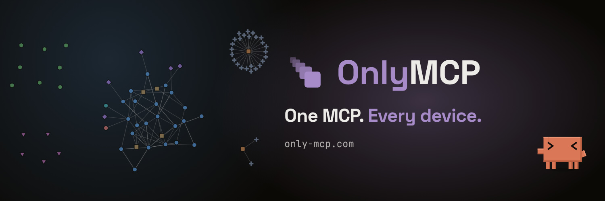
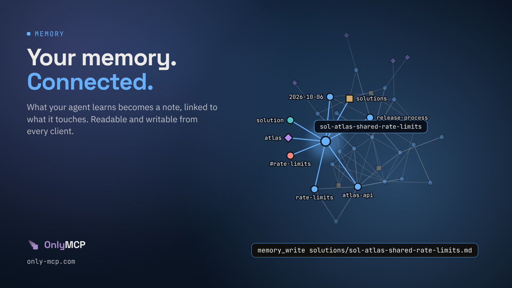
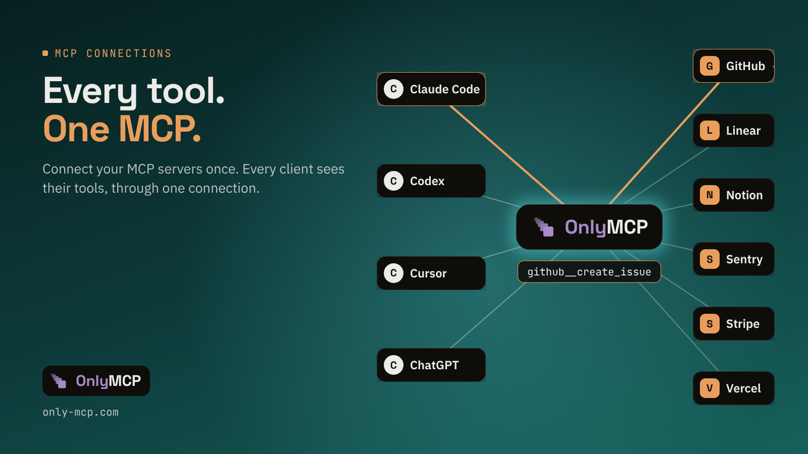
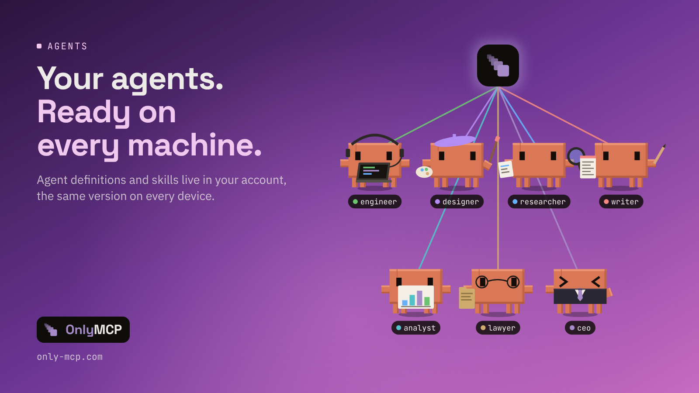
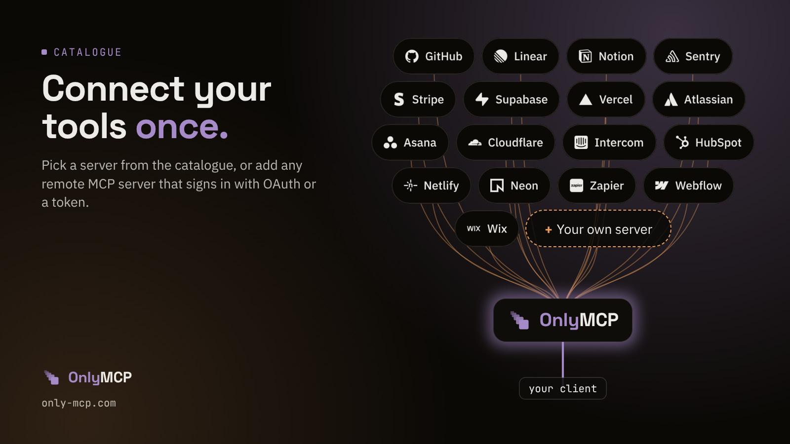

<div align="center">

<a href="https://only-mcp.com"></a>

### Your skills, agents and memory in the cloud, the same in every AI client on every device.

[](https://only-mcp.com)
[](https://only-mcp.com/docs)
[](https://github.com/Francesco070/onlymcp-community/releases/latest)
[](https://www.npmjs.com/package/onlymcp)
[](https://registry.modelcontextprotocol.io/v0/servers?search=com.only-mcp/onlymcp)

**[Get started free](https://only-mcp.com)** · **[Docs](https://only-mcp.com/docs)** ·
**[Report a bug](https://github.com/Francesco070/onlymcp-community/issues/new/choose)** ·
**[Releases](https://github.com/Francesco070/onlymcp-community/releases)**

[](https://x.com/OnlyMCP)
[](https://bsky.app/profile/only-mcp.com)
[](https://www.youtube.com/@onlymcp)
[](https://www.instagram.com/onlymcp.official/)
[](https://www.reddit.com/user/OnlyMCP/)

Works with Claude, ChatGPT, Claude Code, Codex, Cursor, Gemini CLI, Windsurf, Zed, Cline and any other MCP client.

</div>

## What OnlyMCP does

<table>
  <tr>
    <td width="50%" valign="top">
      
      <br><b>Memory</b><br>
      What your agent learns becomes a markdown note, linked to what it touches. Read, write, search and link it from
      any client.
    </td>
    <td width="50%" valign="top">
      
      <br><b>Gateway</b><br>
      Connect your other remote MCP servers once. Every client reaches their tools through the same connection.
    </td>
  </tr>
  <tr>
    <td width="50%" valign="top">
      
      <br><b>Skills and agents</b><br>
      Kept once in your account, the same version on every device, loaded when a conversation needs them.
    </td>
    <td width="50%" valign="top">
      
      <br><b>Catalogue</b><br>
      Pick GitHub, Linear, Notion, Stripe and more from the catalogue, or add any remote MCP server that signs in with
      OAuth or a token.
    </td>
  </tr>
</table>

## Quick start

1. Create a free account at [only-mcp.com](https://only-mcp.com).
2. Point your client at the remote MCP server `https://only-mcp.com/api/mcp` (Streamable HTTP, OAuth 2.1).

**Claude and ChatGPT** (in developer mode): add the address as a custom connector and sign in with OAuth.

**Claude Code:** create an access token under "Connect" on the website, then run

```bash
claude mcp add --transport http --scope user onlymcp https://only-mcp.com/api/mcp \
  --header "Authorization: Bearer omk_…"
```

Setup for Codex, Cursor, Gemini CLI and every other client: [only-mcp.com/docs](https://only-mcp.com/docs). The CLI
`npx onlymcp` imports existing skills, agents and memory from your disk.

## This repository

This is OnlyMCP's public place for bug reports, feature requests and release notes. OnlyMCP is a hosted service: its
source code is private and is not in this repository.

### Report a bug or ask for a feature

[Open an issue](https://github.com/Francesco070/onlymcp-community/issues/new/choose). Issues are public, so leave
out tokens, passwords and the content of your memory files.

### Security

Please do not report a vulnerability in a public issue. [SECURITY.md](SECURITY.md) says how to report it privately.

### Account and billing

Questions about your account, your plan or an invoice: admin@only-mcp.com

### Releases

Every OnlyMCP release is listed under [Releases](https://github.com/Francesco070/onlymcp-community/releases) with
what changed.

### Follow OnlyMCP

News and updates from OnlyMCP:
[X](https://x.com/OnlyMCP) ·
[Bluesky](https://bsky.app/profile/only-mcp.com) ·
[YouTube](https://www.youtube.com/@onlymcp) ·
[Instagram](https://www.instagram.com/onlymcp.official/) ·
[Reddit](https://www.reddit.com/user/OnlyMCP/)

<div align="center">
<br>
<a href="https://only-mcp.com"></a>
<br>
<sub>OnlyMCP is run from Switzerland and hosted in Europe.</sub>
</div>
